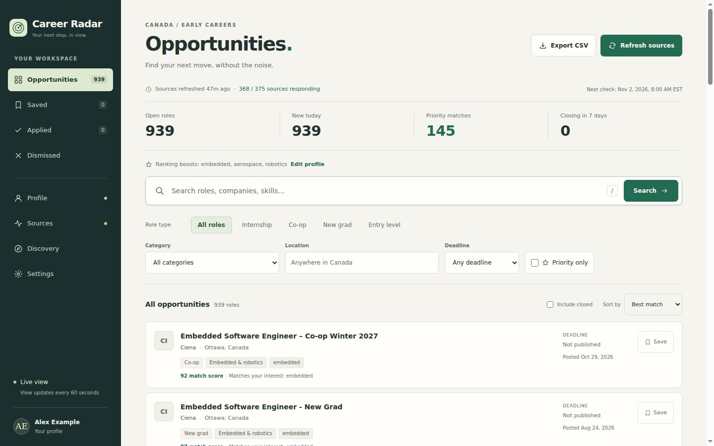
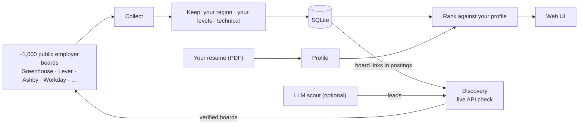
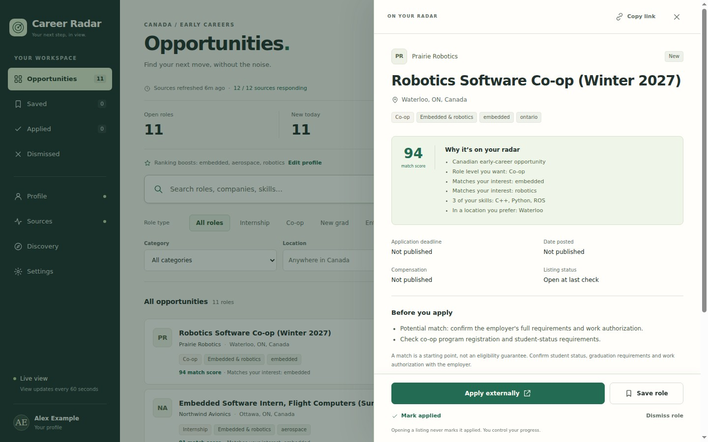
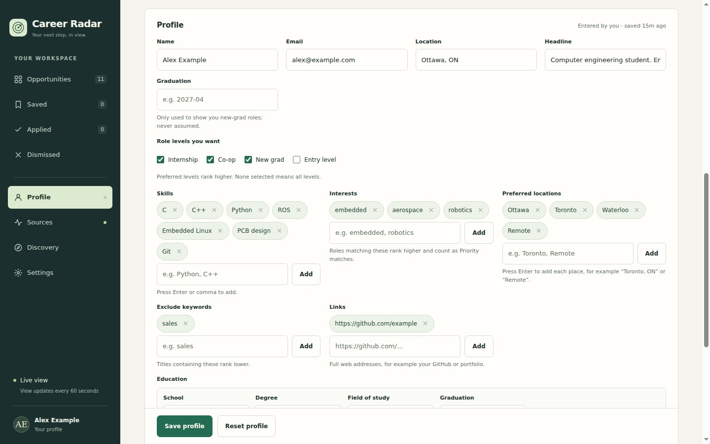
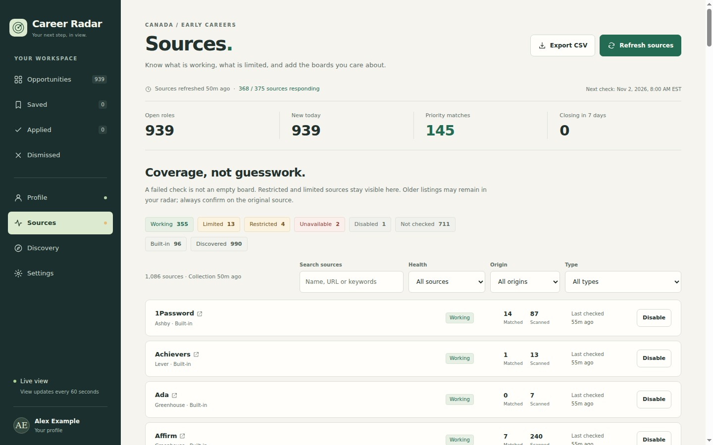
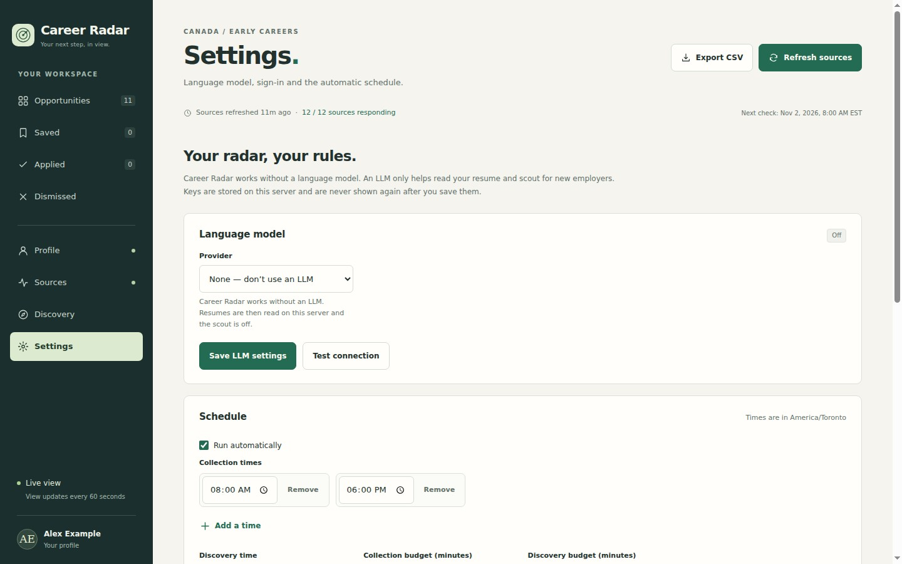

# Career Radar

[](https://github.com/QuestyFella/career-radar/actions/workflows/ci.yml)
[](LICENSE)


A self-hosted job radar for **technical roles at every level, in the region you choose**.
It collects postings straight from employers' public job boards, keeps only roles in your
region, ranks them against your resume and interests, and finds new employer boards on its own.



<sub>A real collection run against public job boards, ranked for a made-up profile.</sub>

## Features

- **Your region, your radar.** Pick a country (Canada is the default), “Anywhere (global)”, or a
  custom region with your own location keywords. Collection, discovery, ranking and the feed all
  follow it. Unrestricted remote roles are included by default; remote roles tied to another
  country are not.
- **Any career level.** Internships, co-ops, new grad and entry level are selected by default.
  Add mid-level and senior roles — or choose “Any level” — to collect experienced roles too.
- **About 1,000 employer boards out of the box.** 96 built-in sources (Greenhouse, Lever, Ashby,
  Workday, LinkedIn public search, Job Bank Canada, Simplify and others) plus 990 boards verified by
  discovery (Workday, Greenhouse, Ashby, Lever, SmartRecruiters, BambooHR, Workable and Recruitee).
- **Your resume ranks the jobs.** Upload a PDF and it extracts your name, education, experience,
  skills and interests, either with built-in heuristics or with your own LLM. Roles that match your
  interests count as *priority matches*. You can edit everything, and nothing is guessed about
  your citizenship, work authorization or graduation date.
- **Add your own sources.** Paste any supported careers-board URL; it is checked live before it
  is added. Add LinkedIn or Job Bank keyword searches, disable any source, or remove a discovered
  board for good.
- **Discovery.** Finds board links in collected postings and in lead files, verifies each one with
  a live public-API check, and keeps the boards that currently list technical roles in your region.
  It re-checks them regularly and drops boards that go stale.
- **Optional LLM scout.** Asks your LLM to suggest employers by theme (aerospace, embedded, AI/ML,
  fintech, games and others). Suggestions are only leads: a board is added after the same live
  check.
- **Bring your own LLM:** OpenAI, Anthropic (Claude), OpenRouter, OpenCode Zen, OpenCode Go,
  ChatGPT sign-in (Codex), or any OpenAI-compatible server such as Ollama or LM Studio. The LLM is
  optional; everything except the scout works without one.
- **A built-in scheduler, so no cron.** By default it collects at 08:00 and 18:00 and runs discovery at 04:30. You can change
  this in Settings.
- **Honest data.** It only shows explicitly published deadlines and never invents salaries or dates.
  Opening a link never marks a job applied. It never applies to jobs for you.

## How it works



## Screenshots

| Job details and match reasons | Profile, filled from your resume |
|---|---|
|  |  |
| **Sources and board health** | **Settings: region, LLM provider and schedule** |
|  |  |

## Quick start (Docker)

```bash
git clone https://github.com/QuestyFella/career-radar.git
cd career-radar
cp .env.example .env        # optional: password, API keys, time zone
docker compose up -d --build
```

Open <http://localhost:8765>. The first collection runs at the next scheduled time; click
**Refresh** to start one now. A full pass over about 1,000 boards takes 20–40 minutes; boards
not reached within the time budget are collected first on the next run.

All state lives in the `career-radar-data` volume (`/data`): the SQLite database, discovered
boards, your sources, profile, resume text, settings and API keys. Back it up with:

```bash
docker run --rm -v career-radar-data:/data -v "$PWD":/backup alpine tar czf /backup/career-radar-data.tgz -C /data .
```

### Without Docker

```bash
python3.12 -m venv .venv && . .venv/bin/activate
pip install -e '.[dev]'
CAREER_RADAR_DATA=./data career-radar serve --port 8765
```

One-off jobs (handy for cron or debugging): `career-radar collect`, `career-radar discover
[--reverify]`, `career-radar scout`, `career-radar status`.

## Configuration

Everything can be set in the web UI. Environment variables (see `.env.example`) override the UI.

**Region** is in Settings: any country, “Anywhere (global)”, or a custom label plus comma-separated
location keywords. **Role levels** are in Profile; select all six (or “Any level”) to collect
experienced roles as well as early-career ones. Both choices apply to the next collection run;
the feed hides stored jobs that no longer match.

| Variable | Purpose |
|---|---|
| `CAREER_RADAR_PASSWORD` | Require HTTP Basic auth (any username). **Set this if others can reach the port.** |
| `CAREER_RADAR_ALLOWED_HOSTS` | Host names to accept besides IP addresses and `localhost` (e.g. `radar.lan`; `*` = any). Protects against DNS rebinding. |
| `CAREER_RADAR_TIMEZONE` | Schedule time zone (default `America/Toronto`) |
| `CAREER_RADAR_DATA` | Data directory (`/data` in Docker) |
| `CAREER_RADAR_SCHEDULER=0` | Turn off the built-in scheduler |
| `CAREER_RADAR_LLM_PROVIDER`, `CAREER_RADAR_LLM_MODEL`, `CAREER_RADAR_LLM_BASE_URL` | Preselect an LLM |
| `OPENAI_API_KEY`, `ANTHROPIC_API_KEY`, `OPENROUTER_API_KEY`, `OPENCODE_ZEN_API_KEY`, `OPENCODE_GO_API_KEY`, `OPENAI_COMPATIBLE_API_KEY` | Provider keys |

### LLM providers

| Provider | What you need | Notes |
|---|---|---|
| OpenAI | API key from platform.openai.com | Chat Completions |
| Claude (Anthropic) | API key from console.anthropic.com | Messages API |
| OpenRouter | API key from openrouter.ai/keys | Any OpenRouter model |
| OpenCode Zen | API key from opencode.ai/auth | Pay-as-you-go; each model is routed to its native API from the public Zen catalog |
| OpenCode Go | API key from opencode.ai/auth | Subscription models |
| ChatGPT (Codex) | A ChatGPT plan | Click **Sign in with ChatGPT** and enter the code shown, the same device sign-in the Codex CLI uses. No API key. |
| OpenAI-compatible | Base URL (key optional) | Ollama: `http://host.docker.internal:11434/v1` |

API keys entered in the UI are stored in `/data/secrets.json` (mode 0600). They are write-only:
the API only ever reports whether a key is set and its last four characters.

**What is sent to the LLM:** for resume extraction, the text of your resume, and only when you
choose an LLM mode that uses it (*Don't send my resume to an LLM* keeps it local). For the scout,
a research theme and a list of already-known board URLs. Job postings are never sent.

## Ranking

Every job starts at a neutral score. With a profile, the score becomes a 0–100 match:

- interests matched in the title, company or topic tags (aerospace, embedded, robotics, machine
  learning, data, security, web, mobile, cloud, games, fintech, automotive, quantum, health,
  networking, or any free-text term);
- your skills found in the posting;
- preferred locations and role levels (internship, co-op, new grad, entry level, mid level or
  senior level);
- excluded words in the title, which push a job down.

*Priority only* shows the jobs that match an interest or score 75 or higher.

## Scope and filters

Career Radar keeps technical postings (software, data, AI/ML, embedded, electrical, IT, QA,
product and related titles) that are located in your region, or that are unrestricted remote
roles. The default region is Canada, with the four early-career levels selected. Choose another
country, “Anywhere (global)” or a custom region in **Settings**; choose mid-level and senior
roles — or “Any level” — in **Profile**. Roles outside your region or selected levels, non-technical
titles and postings that require another country are dropped. Multi-country postings are kept when
they name a location in your region.

## Sources and discovery

**Sources** lists every board with its health: last check, raw and matched counts, and errors.
Use it to add a board (paste a careers URL, check it live, then add it), add a keyword search,
disable or remove a board, and see which boards are built-in, discovered or yours.

Supported board URLs:

- Greenhouse: `job-boards.greenhouse.io/<board>` or `boards.greenhouse.io/<board>`
- Lever: `jobs.lever.co/<board>`
- Ashby: `jobs.ashbyhq.com/<board>`
- Workday: `<tenant>.wd<N>.myworkdayjobs.com/<site>`
- SmartRecruiters: `jobs.smartrecruiters.com/<Company>`
- Workable: `apply.workable.com/<account>`
- Recruitee: `<account>.recruitee.com`
- BambooHR: `<account>.bamboohr.com/careers`

**Discovery** reads board links from collected postings and from any lead files you drop in
`/data/leads/`. A lead file can be JSON, JSONL, CSV, Markdown or text containing board URLs.
Discovery probes each new board through its public API with the same adapters collection uses,
and adds it when it has a current technical posting in your region. Discovered boards are re-verified
every 30 days, and failing boards every night. Boards you remove are never re-added.

## Privacy and safety

- It is meant for your own machine or home network. Do not expose it to the internet without a
  password and HTTPS (put it behind a reverse proxy).
- All writes require same-origin JSON requests. The UI ships a strict Content-Security-Policy.
- Collection only reads public job-board APIs and pages, with polite rate limits and a clear
  User-Agent. It never logs in anywhere, and it never applies to jobs or contacts recruiters.
- Your resume and profile stay in your data volume. They are sent to an LLM only as described
  above.

## Development

```bash
pip install -e '.[dev]'
pytest -q
node --test career_radar/static/ui.test.cjs   # UI helpers (Node 20+)
```

The suite (about 2,600 Python tests and 150 UI tests) runs fully offline.

The project layout:

- `career_radar/app.py`: the API and UI server.
- `collect.py`, `adapters.py` and `extras.py`: collection and the source adapters.
- `core.py`: normalization, filters, the database and deadlines.
- `discover.py`: discovery.
- `registry.py`: built-in, user and discovered sources.
- `profile.py` and `ranking.py`: resume extraction and the matcher.
- `llm.py` and `codex_auth.py`: the LLM providers.
- `scheduler.py`: the built-in scheduler.
- `docs/API.md`: the HTTP API.

## Roadmap

- Adapters for more applicant-tracking systems (iCIMS, Oracle Recruiting Cloud, UKG and others).
- Merge the same posting when an employer lists it on two of its own boards.
- A prebuilt image on GitHub Container Registry.

Issues and pull requests are welcome.

## License

MIT. See [LICENSE](LICENSE).
